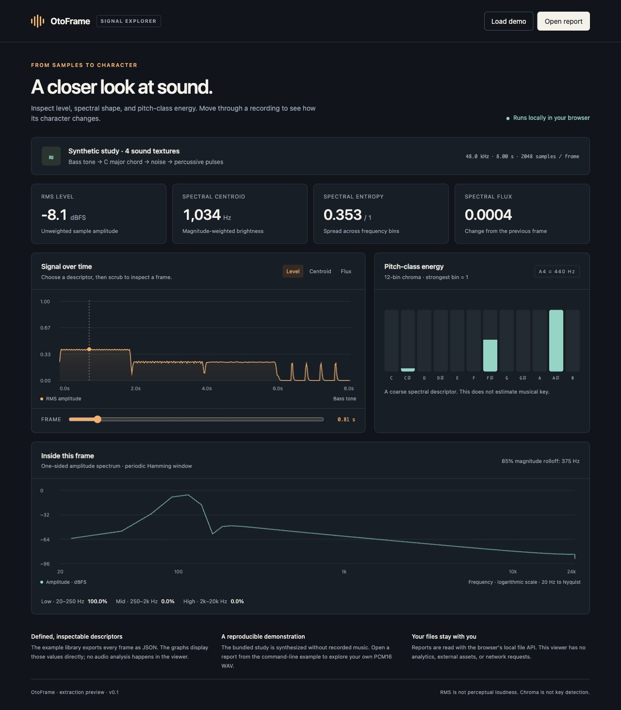

# OtoFrame

A small C++17 library for inspecting the level, spectral shape, and pitch-class energy of mono PCM audio. Extracted from an existing audio application, with documented changes to FFT scaling and descriptor definitions.

**Current status:** private development preview. Local Apple Silicon macOS tests and GitHub CI on macOS (both FFT backends), Linux, and Windows have passed. No live microphone or iOS-device validation is claimed.



## Try it

The [signal explorer](demo/index.html) is a self-contained HTML file. Open it directly in a browser. It includes a deterministic eight-second study: bass, chord, noise, and percussive pulses. No server, account, network request, or recorded music is required.

On macOS or Linux, build and run the numerical and WAV tests:

```sh
./build.sh
# To use the portable FFT on macOS:
./build.sh --portable
```

This needs a C++17 compiler and Python 3.9+; Python is used only by the example tests and demo builder. On macOS, install Apple's Command Line Tools if a compiler is not available. The library itself has no third-party dependencies.

Analyze your own **PCM16 RIFF WAV**, mono or stereo, up to 60 seconds:

```sh
build/otoframe --wav recording.wav --output build/report.json
```

In the explorer, choose **Open report** and select the JSON. Stereo is averaged to mono; opposing channel polarities can cancel. The example reads at most 64 MiB and the viewer accepts reports up to 64 MiB. High sample rates and long recordings may create larger reports; analyze a shorter segment in that case. The reader intentionally supports PCM16 only; the core accepts normalized Float32 PCM from any decoder.

For CMake-based hosts and Windows:

```sh
cmake -S . -B build -DCMAKE_BUILD_TYPE=Release
cmake --build build --config Release
ctest --test-dir build -C Release --output-on-failure
```

## Embed in an audio application

```cpp
#include <otoframe/extractor.hpp>

// Construct outside the audio callback. One instance per mono stream.
otoframe::Extractor extractor(2048, 48000);
otoframe::Features features;

// PCM: finite floats in [-1, 1], 1..2048 samples.
if (extractor.process(pcm, sample_count, features)) {
    // Copy features to a consumer through your host's synchronization mechanism.
    // features.rms, features.centroid_hz, features.chroma, ...
}
```

Include `include/` and compile as C++17. Link `-framework Accelerate` on Apple platforms. Define `OTOFRAME_PORTABLE=1` to select the included radix-2 FFT instead. The process/reset paths preallocate their C++ storage and perform no C++ heap allocations in the measured tests. This does not establish a hard real-time guarantee or audit internal allocations in system frameworks.

## What it measures

| Descriptor | Meaning |
|---|---|
| RMS / peak | Unwindowed, linear sample amplitude |
| Spectral centroid | Magnitude-weighted mean frequency, Hz |
| 85% rolloff | Frequency containing 85% of cumulative **magnitude**, Hz |
| Spectral entropy | Entropy of normalized magnitudes, divided by log₂(bin count) |
| Spectral flux | RMS difference of adjacent amplitude spectra; first frame marked unavailable |
| Band power ratios | Fractions of windowed spectral power in low/mid/high frequency bands |
| Chroma | Power assigned to the nearest equal-tempered pitch class; max-normalized |

Read [the exact equations and edge cases](docs/ALGORITHMS.md), [extraction decisions](docs/EXTRACTION.md), and [validation results](docs/VALIDATION.md).

These are descriptive features for visualization and lightweight audio/haptic prototyping. RMS is unweighted level, not perceived loudness or LUFS. Chroma is coarse at low frequencies and does not estimate key or pitch confidence. Frame size, sample rate, window, and hop change results; compare recordings using the same configuration.

For a broad music-information-retrieval toolkit, see [Essentia](https://essentia.upf.edu/documentation.html). [Gist](https://github.com/adamstark/Gist) also provides C++ audio descriptors. This project's focus is a small inspectable extraction, explicit units, an offline viewer, and independent numerical checks. No algorithmic novelty is claimed.

## Project map

```text
include/otoframe/extractor.hpp   C++17 processing API and two FFT backends
examples/analyze.cpp                  Synthetic study / PCM16 WAV → JSON
examples/build_demo.py                Embed a synthetic report in the offline viewer
demo/index.html                       Ready-to-open signal explorer
demo/viewer.template.html             Viewer source
tests/                               Numerical contracts and malformed WAV cases
docs/                                Equations, extraction decisions, local evidence
```

The core leaves decoding, resampling, stereo policy, scheduling, and transport to the host. It has no audio-device access, app billing, analytics, emotion classification, or remote upload logic. Contributors should keep numerical definitions explicit and add an independent expected result when changing DSP behavior; see [CONTRIBUTING.md](CONTRIBUTING.md).

## 日本語

既存の音響アプリから音声特徴量の抽出処理を独立させた、小さなC++17ライブラリです。音量、音の明るさ、音の変化量、12音の成分を取得できます。プライベート開発版で、リポジトリ名はOtoFrameです。

`demo/index.html` を開くと、合成音の分析結果をブラウザで確認できます。`./build.sh` でテストとデモを再生成できます。元の実装と単位・定義を整理した公開版では一部の数値が変わるため、互換性の詳細は抽出記録に明記しています。元のアプリには変更を加えていません。

## License

[MIT](LICENSE). Includes original portable FFT code and links Apple's system Accelerate framework when available. There is no bundled third-party DSP implementation or recorded-music asset. The repository is private during development. Public release is a separate decision.
